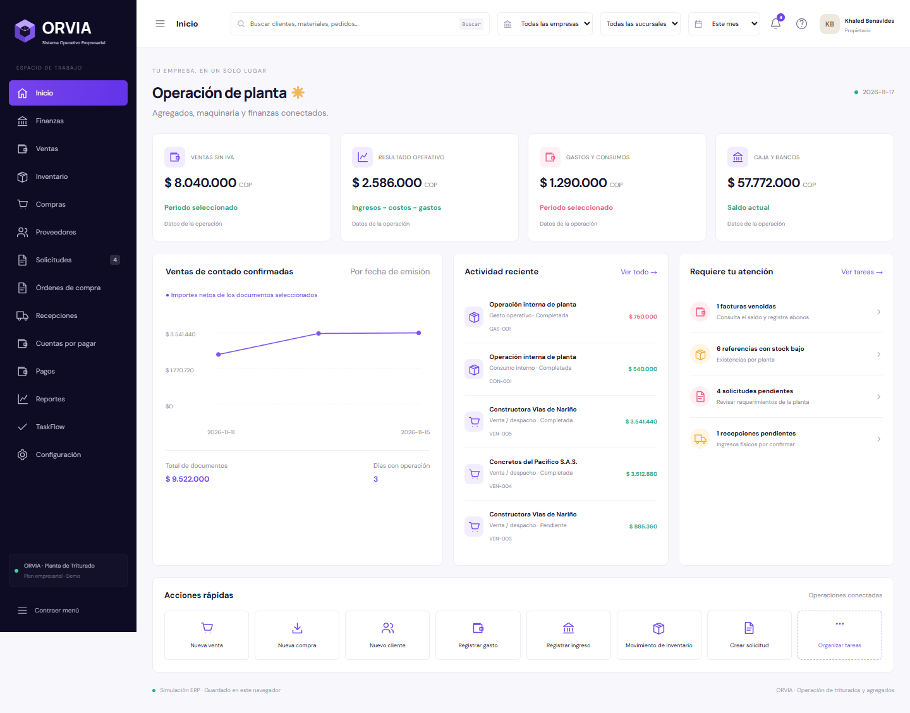

# ORVIA · Sistema Operativo Empresarial

Frontend educativo en **Angular 21**, TypeScript y SCSS, basado en las 13 pantallas del PDF de referencia. Adaptado a una trituradora de piedra, materiales de construcción y empresas comercializadoras.



## Ejecutar

Instala **Node.js 24 con npm** y Git. No necesitas instalar Angular CLI globalmente, configurar claves ni levantar un backend. Los comandos sirven en Windows, macOS y Linux.

```powershell
git clone https://github.com/KhaledBO29/ORVIA-INTERFAZ-.git
cd ORVIA-INTERFAZ-
npm ci
npm start
```

`npm start` inicia el servidor y abre el navegador en http://localhost:4200. Mantén la terminal abierta mientras uses la aplicación; para detenerla, pulsa `Ctrl+C`.

Si descargaste el ZIP, descomprímelo, abre una terminal en la carpeta que contiene `package.json` y ejecuta `npm ci` y `npm start`. La rama `main` ya contiene la aplicación completa.

Si el navegador no se abre automáticamente, entra manualmente a la dirección que muestra la terminal. Para ejecutar sin abrir el navegador, usa `npm run start:headless`. Si el puerto está ocupado, puedes usar `npm start -- --port 4300` y abrir http://localhost:4300.

La dirección local funciona en el equipo donde ejecutas el proyecto. Cada persona que lo clone ejecuta su propia copia. Los datos de demostración se guardan en su navegador y no se comparten con otros usuarios.

Para compilar: `npm run build`. Salida: `dist/orvia/browser`. No abras `src/index.html` ni el archivo compilado con doble clic: la aplicación necesita un servidor web con redirección de sus rutas a `index.html`.

## Aprender y revisar

- [Guía componente por componente](docs/APRENDER-ANGULAR.md): explicaciones, ejercicios y ensamblaje.
- [Ramas, commits y pull requests](docs/GIT-Y-PR.md): flujo de un solo desarrollador y orden de implementación.
- [Matriz de requisitos](docs/REQUISITOS.md): ubicación exacta de cada concepto solicitado.
- [Alcance y validación](docs/VALIDACION.md): comportamiento real y diferencias respecto al diseño.
- [Operación ERP relacional](docs/ERP.md): recorrido de compras, stock, ventas, pagos y reglas de cálculo.
- [Entregas y enlaces a los PR](docs/ENTREGAS.md).
- [Plantilla de PR de la UCC](.github/pull_request_template.md).

## Pantallas

Inicio, finanzas, ventas, inventario, compras, proveedores, solicitudes, órdenes de compra, recepciones, cuentas por pagar, pagos, reportes, configuración y TaskFlow.

Cada módulo consulta sus entidades y documentos. El flujo **solicitud → orden → recepción → inventario / cuenta por pagar → abonos** mantiene vínculos y saldos. Las ventas descontarán stock al confirmar el despacho y registrarán el ingreso y su costo. TaskFlow organiza las tareas de planta.

## Validar

```powershell
npm run typecheck
npm run build
npm test
```

`typecheck` revisa los tipos de la aplicación y de las pruebas de Playwright. La configuración declara `rootDir` explícitamente para evitar el diagnóstico TS5011 de editores con TypeScript 6; Angular utiliza la versión TypeScript 5.9 del proyecto. En VS Code puedes seleccionar **TypeScript: Select TypeScript Version → Use Workspace Version**.

En Windows las pruebas usan Google Chrome instalado. En Linux/macOS instala Chromium con `npx playwright install chromium`. La configuración inicia Angular automáticamente cuando el puerto 4200 está libre.

## Demostración

La demostración incluye agregados, bandas, rodamientos, tornillos, tuercas, mallas, diésel y aceite. Permite documentos con varios productos, precios y cantidades editables, IVA por línea, retención, transporte y cargador. Las recepciones actualizan el costo promedio por planta y la deuda; los despachos y consumos descuentan existencias. Se bloquean las salidas sin stock y los abonos superiores al saldo.

Los indicadores, alertas, reportes y gráficas se calculan desde documentos y saldos; los movimientos confirmados generan asientos simulados con débito igual a crédito. Proveedores y clientes se crean, editan e inactivan conservando su historial. Las tablas permiten búsqueda, filtros, paginación, detalles y exportación CSV con unidades.

Configuración controla las tasas predeterminadas de nuevos documentos, capacidad de volqueta para estimar viajes, notificaciones y métodos de abono. Los datos se conservan **en este navegador mediante LocalStorage**, con respaldo JSON descargable. La fecha y los períodos usan la zona horaria de Bogotá.

Es un frontend con contabilidad interna **simulada**, sin backend, autenticación, bancos ni facturación electrónica. Las tasas son parámetros educativos. Las recepciones son completas y los documentos confirmados no se editan ni revierten. Consulta el [alcance de la simulación](docs/ERP.md).

Las fuentes de Google son opcionales; existe una alternativa local Arial. Los iconos y el logo se dibujan con SVG locales.

Desarrollador: **Khaled Benavides**. El orden del gráfico es **main cian → develop rosado → features verdes**. Las features se encadenan desde la anterior, se integran mediante PR a develop y luego se publica develop en main mediante otro PR. Consulta [el flujo y sus colores](docs/GIT-Y-PR.md).
